# 瀑布相册 · fnPhotowall

一个为飞牛fnOS打造的简洁瀑布流相册应用

支持索引快照秒开、缩略图缓存、原图超清查看、文件夹视图、EXIF 详情、视频零拷贝播放

纯 Python 标准库后端 + 无框架前端，安装即用，无需 Node、Docker 或任何 pip 依赖


---

## 功能

### 瀑布流浏览

- **启动即用（索引快照）**：每次扫描完把索引结构落盘，下次启动直接读快照（约 30–70 ms），**不再全盘重扫**；随后在后台静默校正，期间照常用旧索引服务。
- **后台扫描让路**：后台重扫每遍历 40 个目录检查一次缩略图队列，有积压就主动歇一下，不与正在看的那屏抢磁盘
- **每页 60 张**：更小的一页更快返回，首屏秒开，滑到底部自动接着加载
- 服务端在返回这一页时，顺手把**下一页的缩略图**排到队列尾部预生成（本页插队首、下页排队尾），减少滑动等待
- 距离底部还有 1.4 屏时就开始取下一页，不会出现「滑到底停住」的空窗
- **缓存优先**：已在缩略图缓存池里的照片排在前面，打开就是秒出；后面才是待生成的
- 右上角「**换一批**」：重新打乱 + 顺带刷新目录
- **首屏优先**：前 12 张 `fetchpriority=high` 直接加载，其余 `loading=lazy`，滚动才取
- **分帧渲染**：每 30 张一帧插入，主线程不卡；未加载的卡片显示骨架微光
- 卡片宽度自适应列数：手机2列、平板3–4列、桌面端4–6列
- 首次进入只请求图片流，视频流切过去时才拉取；JSON 走 gzip

### 大图浏览

- 点击任意照片/视频进入全屏浏览，支持左右滑动（手机）、方向键（电脑）
- **清晰度**：默认加载 1920 / 2560 宽的高清预览（秒开）。三条路径拿到原图：
  1. **自动**——放大超过预览的像素密度时，后台自动换成原图，继续放大不再糊；
  2. **手动**——点 dock 的「超清」，按钮变「超清 ✓」；若当时是 1×，会自动推近到 2× 让细节变化立刻可见；
  3. **1:1**——右上角按钮（快捷键 `1`）直接按原始像素显示
  原图状态下最大放大倍率从 8× 提升到 **16×**；本身就不比预览大的小图会直接标记为原图，不浪费一次请求
- **缩放**：鼠标滚轮 / 触屏双指捏合，放大后可拖动平移，双击在 1× 与 2.6× 之间切换，按 `0` 复位；放大状态下不会误触发切图
- 左上角信息区显示照片所在位置：`📁 上上级 / 上级 / 当前文件夹`（保留三级，长路径自动省略），**点击直接跳到文件夹视图**
- **视频播放**：服务端用 `sendfile` 零拷贝直传，Range 请求只发送需要的片段，4K 高码率视频也能稳定拖动

**底部 dock 五个动作（顺序：超清 / 原图 / 收藏 / 删除 / 详情）**

| 动作 | 快捷键 | 说明 |
| --- | :---: | --- |
| **超清** | `U` | 在应用内快速加载原始文件，可放大到 100%  |
| **原图** | `O` | 在当前页面叠一层**全屏超清视图**：以原生分辨率显示、滚轮/双指缩放、拖动平移、双击切换倍率。左上角**返回**图标收起该层，右上角**下载**图标把原图存到本地 |
| **收藏** | — | 加入「我的收藏」文件夹（优先用硬链接，不额外占用空间） |
| **删除** | — | 二次确认后从磁盘真正删除（同时清理收藏夹里的对应文件） |
| **详情** | `I` | 拍摄时间 / 修改时间、相机型号、镜头、光圈、快门、ISO、焦距、文件名、尺寸、占用空间、文件路径 |


### 文件夹视图（资源管理器风格）

- **根目录直接展开授权路径内部**：不再展示授权路径这一层。例如授权 `/vol1/Photos` 时，进入文件夹视图直接看到「Photos」里的子文件夹与散落文件，「我的收藏」仍作为独立入口置顶
- 地址栏右侧「**复制地址**」：一键复制当前文件夹的绝对路径（如 `/vol1/Photos/2026.11`），HTTP 环境下自动回退到 `execCommand` 复制
- 文件夹以**大图标 + 相册内图片缩略图**展示，带项目数量
- 顶部工具栏：后退 / 前进 / 上一级、当前路径面包屑（可点击任意层级）、刷新
- 严格按磁盘真实层级导航（`os.scandir`），进入目录后展示该目录下的媒体文件

### 预加载（设置里可开关）

- 点「开始预加载」：后台按随机顺序把整个相册的缩略图灌进缓存池，一直跑到设定的缓存上限
- 随时「暂停加载」；设置里能看到进度条、已处理张数、缓存池占用
- 队列积压时会自动等待，不会和正在查看的队列抢带宽
- 预加载完成后，任何一屏瀑布流都直接从磁盘出图

### 缩略图缓存（默认 10 GB 上限 / 保底 20 屏）

- 落盘位置 `$TRIM_PKGVAR/thumbs`，文件名 = `路径+mtime+宽度` 的 SHA1，源图改了自动换新
- 多线程生成（默认 8 线程，Pillow → ffmpeg 两级降级），同一张图并发请求只算一次
- 缓存上限 **10 GB**（可调至 2/5/20/50 GB），超出后按「最久未访问」淘汰到 85%
- **保底 5000 张**（= 20 次 × 250 张），反复「换一批」不会把刚看过的缩略图挤掉
- 后台每 **10 分钟**巡检一次；启动后再做一次异步巡检；中断遗留的临时文件自动清理
- 可通过 `/api/cache` 查看用量，`/api/cache?prune=1` 立即清理

### 设置

- 缓存位置：可选「应用数据目录」「应用共享目录」「各授权目录所在磁盘的隐藏目录」，每项显示剩余空间，切换后旧缓存自动清理并重建（配置文件 `settings.json` 持久化）
- 缓存占用空间：2 / 5 / 10 / 20 / 50 GB 一键切换，改完立即按新上限清理
- 一键清理：立刻清掉最久未使用的缩略图
- 界面主题：深色 / 浅色，按设备记忆（`localStorage`），大图浏览区始终保持深色以便看清照片

### 安全边界

- 只能访问用户在「应用设置 → 授权目录」中授权的文件夹（`TRIM_DATA_ACCESSIBLE_PATHS`）
- 所有请求路径经 `realpath` 归一化 + 前缀校验，拒绝 `..` 穿越与授权目录外的越权访问
- 以专用包用户（`run-as: package`）运行，不使用 root

---

## 界面预览

### 电脑端

| 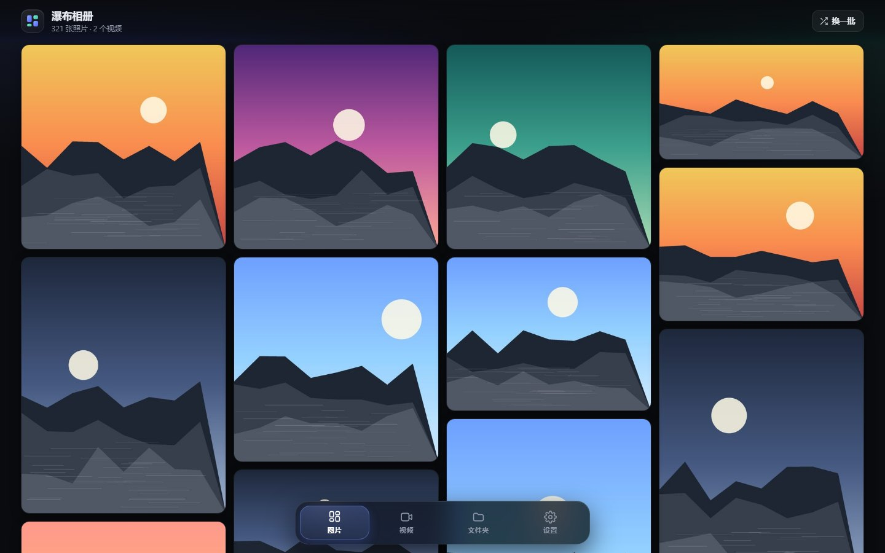<br>**首页 · 瀑布流** | <br>**大图浏览 + dock** |
| :---: | :---: |
| <br>**超清层**（原图全屏查看，可下载） | 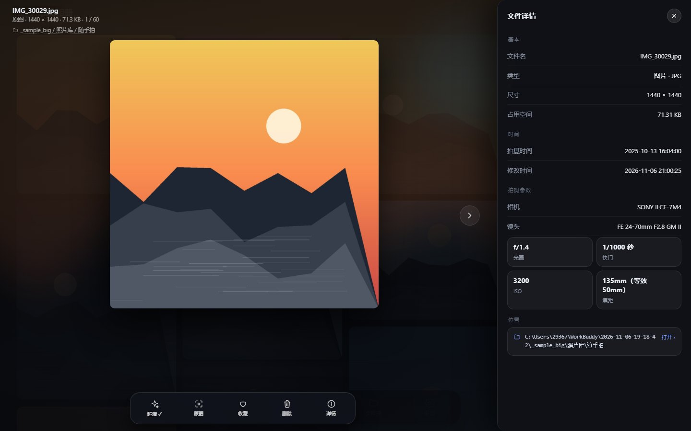<br>**详情面板**（EXIF + 可点击路径） |
| 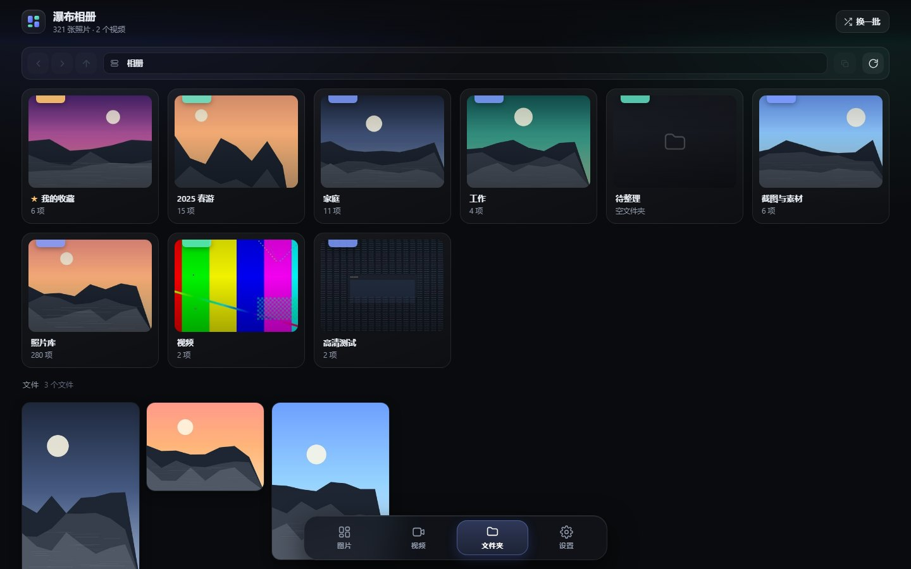<br>**文件夹视图**（根目录直接展开授权路径内部） | 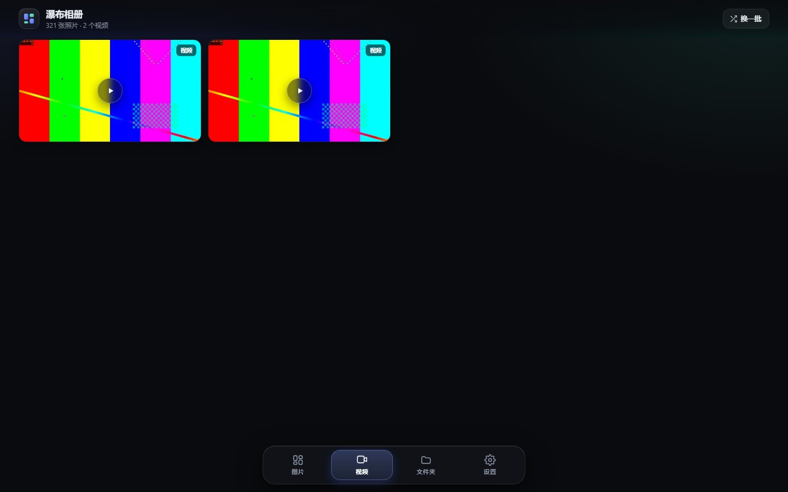<br>**视频播放**（零拷贝 + Range 拖动） |
| 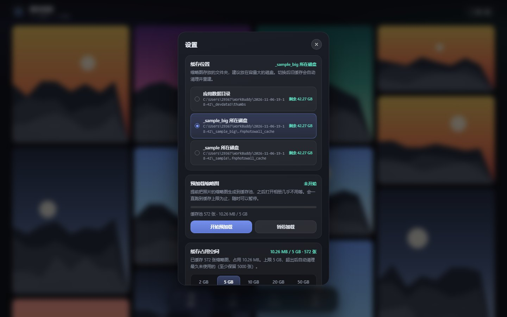<br>**设置**（缓存 / 主题 / 预加载） | 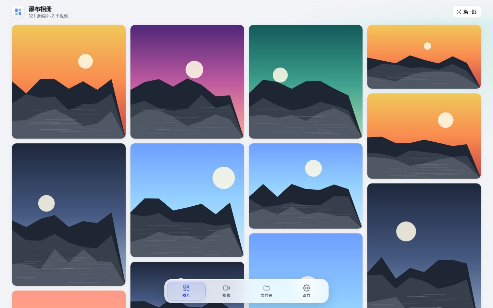<br>**浅色主题 · 首页** |
| 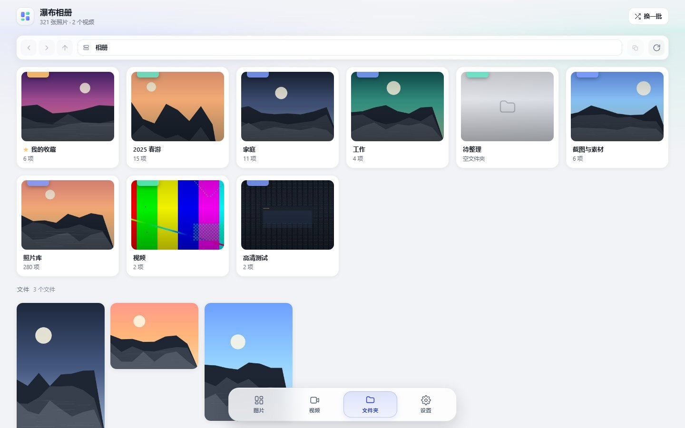<br>**浅色主题 · 文件夹** | |

### 手机端

| 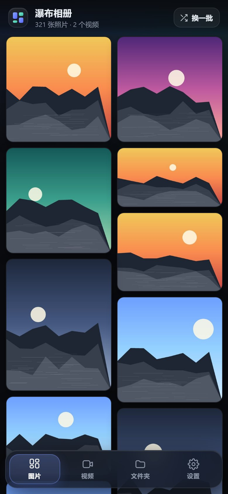<br>**首页 · 双列瀑布流** | 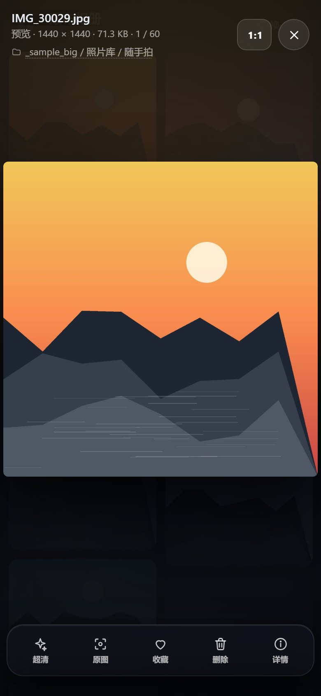<br>**大图浏览** |
| :---: | :---: |
| 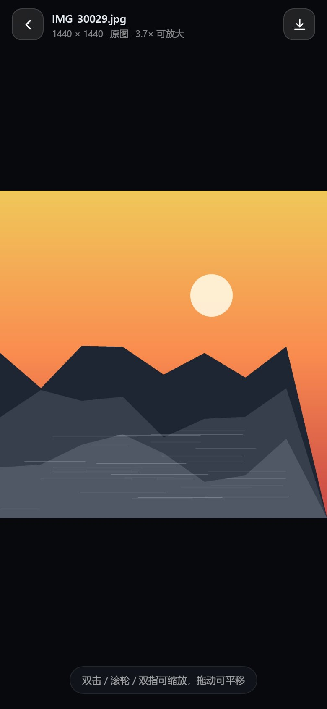<br>**超清层**（返回只收层，不跳页） | 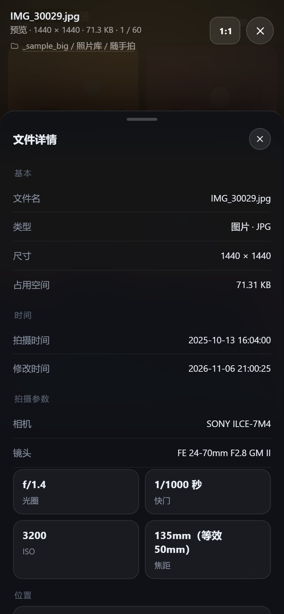<br>**详情** |
| 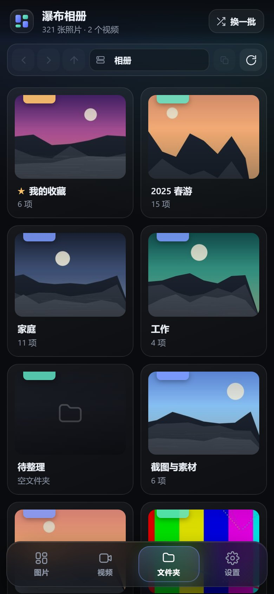<br>**文件夹视图** | |

---

## 版本迭代

| 版本 | 主要更新 |
| --- | --- |
| **v1.3.11** | **启动提速**：索引落盘为快照，重启直接读取不再全盘重扫（2 万张从 10.9 s → 0.3 s）；缓存优先标记一并存入快照，省掉每次请求 500 ms 的哈希计算；后台重扫主动给缩略图让路 |
| **v1.3.10** | 超清层顶栏简化：返回只保留图标（去掉文字），右上角 `1:1` 改为**下载**图标，一键把原图存到本地 |
| **v1.3.9** | 超清改为**应用内全屏层**，彻底解决手机（飞牛自带 WebView）点原图返回后跳主页重载——全程零页面导航 |
| **v1.3.8** | 「超清 / 原图」功能互换并调整为 dock 前两位（快捷键 `O`/`U` 同步互换）；主页每页 100 → **60 张**，首屏更快 |
| **v1.3.7** | 路径跳转再优化：请求前先更新目标路径、加 8 秒超时，慢请求时不再显示成根目录 |
| **v1.3.6** | 文件夹视图根目录**直接展开授权路径内部**，不再多一层「授权路径」节点 |
| **v1.3.5** | 修复大图路径跳转前几次失效（skipLoad + 请求序号竞态保护） |
| **v1.3.4** | 修复超清页竖屏图下半部分看不到（grid 子项补 `min-height:0`） |
| **v1.3.3** | 修复超清页电脑端拖动中断（改用 Pointer Events + `setPointerCapture`） |
| **v1.3.2** | 新增超清独立查看页与返回按钮；大图左上角路径提到三级且可点击跳转 |
| **v1.3.1** | 每页 100 张 + 下一页缩略图预生成；大图显示所在文件夹；文件夹视图「复制地址」 |
| **v1.3.0** | 缩略图预加载（可暂停/续跑）；放开单页上限；缓存优先排序；「换一批」合并为单按钮 |
| **v1.2.1** | 修复「点原图没变化」：自动升级原图 + 1:1 按钮 + 动态放大上限 |
| **v1.2.0** | 预览提升到 1920 / 2560；新增原图按钮；视频零拷贝直传；缓存目录可选 |
| **v1.1.0** | 修复点错图与首屏空白；大图缩放/拖动；设置面板；深色/浅色主题 |
| **v1.0.0** | 首个版本：瀑布流、文件夹视图、详情与 EXIF、收藏、缩略图缓存 |

---

## 目录结构

```
fnphotowall/
├── manifest                 # 应用元数据（统一网关入口、无固定端口）
├── ICON.PNG / ICON_256.PNG  # 应用中心图标
├── docs/                    # README 截图
├── config/
│   ├── privilege            # 以专用用户 fnphotowall 运行
│   └── resource             # 声明共享目录 fnphotowall（收藏夹放在这里）
├── app/
│   ├── server/photowall.py  # 后端服务（零第三方依赖）
│   └── ui/                  # 前端（index.html / app.css / app.js）
│       ├── config           # 桌面入口：/app/fnphotowall → app.sock
│       └── images/
├── cmd/                     # 生命周期脚本（install / main / config / uninstall）
└── wizard/                  # 安装向导（本应用无需额外输入）
```

安装后：

| 路径 | 内容 |
| --- | --- |
| `/var/apps/fnphotowall/target` | 程序文件（后端 + 前端） |
| `/var/apps/fnphotowall/var` | 缩略图缓存（默认上限 10 GB）、**索引快照 `index/`**、收藏索引 `favorites.json` |
| `/vol1/fnphotowall/收藏` | 收藏夹（共享目录，文件管理器可见） |
| `/var/apps/fnphotowall/target/app.sock` | 统一网关转发用的 Unix Socket |

---

## 构建

```bash
# 1. 下载 fnpack（Windows / Linux / macOS 版本见开发者文档）
#    https://developer.fnnas.com/docs/cli/fnpack/
fnpack build --directory fnphotowall
# 产物：fnphotowall/fnphotowall.fpk
```

> 打包前记得清掉 `app/server/__pycache__`，否则会被打进 `app.tgz`。

## 安装与配置

1. **下载**：到 [Releases](../../releases) 页面下载最新的 `fnphotowall.fpk`（仓库不存放构建产物）
2. **安装**：飞牛桌面 →「应用中心」→ 左下角 `…` →「手动安装」，选择 `fnphotowall.fpk`；
   或命令行：`appcenter-cli install-local ./fnphotowall.fpk`
3. **授权相册目录**：应用中心 →「瀑布相册」→ 设置 → 授权目录 → 选择你的照片文件夹（例如 `/vol1/Photos`）。
   授权后应用会自动重启并加载新的可访问路径。
4. **打开**：桌面图标「瀑布相册」，或直接访问 `http://<NAS地址>:5666/app/fnphotowall`

> 没有授权任何目录时，首页会提示「去授权一个文件夹」。

## 运行依赖与降级策略

| 依赖 | 用途 | 缺失时 |
| --- | --- | --- |
| `python3` ≥ 3.8 | 后端服务 | 安装阶段直接拦截并提示 |
| `ffmpeg` | 视频封面、图片缩略图 | 降级到 Pillow；再不行则原图直出 |
| `Pillow` | 高质量缩略图（可选） | 自动改用 ffmpeg |
| `ffprobe` | 视频分辨率、时长 | 卡片比例改由缩略图自动校正 |

想获得最流畅的滚动体验，建议系统里至少存在 `ffmpeg` 或 `python3-pil` 之一。

## 缩略图缓存调优

默认值即可满足「10 GB 上限 + 保底 20 屏」，需要调整时三种方式任选：

1. 命令行参数（`cmd/main` 里加即可）：
   `--thumb-gb 10 --thumb-keep 5000 --thumb-workers 8`
2. 配置文件 `$TRIM_PKGETC/config.json`：
   ```json
   { "thumb_cache_gb": 10, "thumb_keep": 5000, "thumb_workers": 8 }
   ```
3. 环境变量：`PHOTOWALL_THUMB_GB`、`PHOTOWALL_THUMB_KEEP`

运行时查看用量：

```bash
curl http://<NAS>:5666/app/fnphotowall/api/cache
# {"stats":{"count":5000,"bytes":...,"bytesText":"412 MB","limitText":"10 GB","minKeep":5000,...}}
curl "http://<NAS>:5666/app/fnphotowall/api/cache?prune=1"   # 立刻清理一次
```

## 本地调试（不打包）

```bash
# 用本地样例目录启动一个普通 HTTP 端口，便于浏览器调试
python3 app/server/photowall.py \
  --port 8787 \
  --static app/ui \
  --data ./_devdata \
  --root /path/to/photos \
  --fav ./_devfavorites
# 打开 http://127.0.0.1:8787/
# 访问 http://127.0.0.1:8787/app/fnphotowall 可模拟统一网关前缀
```

## 接口一览

| 方法 | 路径 | 说明 |
| --- | --- | --- |
| GET | `/api/roots` | 可访问的根目录与收藏夹 |
| GET | `/api/media?kind=image&#124;video&seed&offset&limit` | 随机打乱后的媒体列表（`limit=0` 不限量；缓存优先；返回 `cached` 计数） |
| GET | `/api/folder?path=` | 目录内容（子文件夹 + 媒体文件 + 面包屑；`path` 为空时直接展开授权路径内部） |
| GET | `/api/detail?path=` | 文件详情 + EXIF |
| GET | `/api/thumb?path=&w=480` | 缩略图（磁盘缓存 + 后台预生成） |
| GET | `/api/file?path=` | 原文件，支持 `Range`（视频拖动进度）；`download=1` 返回 attachment |
| GET | `/api/cache?prune=1` | 缩略图缓存用量 / 立即清理 |
| GET | `/api/preload` | 预加载状态（运行中、已处理、进度、缓存占用） |
| POST | `/api/preload` | `{action: start&#124;stop}` 开始 / 暂停预加载 |
| POST | `/api/favorite` | `{path, action: add&#124;remove}` |
| POST | `/api/delete` | `{path, confirm: true}`，缺 confirm 一律拒绝 |
| GET | `/api/settings` | 读取用户设置、缓存统计与可选缓存目录列表 |
| POST | `/api/settings` | `{cache_limit_gb: 0.5~200}` 改上限；`{cache_dir: "..."}` 换缓存目录（只接受列表内路径） |
| GET | `/api/health` | 运行状态、Pillow/ffmpeg 可用性、缓存统计、根目录 |
| GET | `/ultra.html?path=` | 超清查看页（旧版独立页面，保留作兜底；主界面已改用应用内全屏层） |

## 性能实测（本地 319 张样张、8 线程）

| 指标 | 数值 |
| --- | --- |
| **进入相册（重启后，2.1 万张）** | **0.3 s**（索引快照命中，此前需全盘重扫 10.9 s） |
| 索引快照加载 | 0.03–0.07 s |
| 250 张列表接口（缓存热） | **7–9 ms**，gzip 后 8.9 KB |
| 250 张列表接口（重启后首次） | 92 ms（顺带解析 250 个图片头，结果留在内存） |
| 首张卡片出现 | 324–470 ms（每页 60 张） |
| 一次「换一批」到 250 张渲染完成 | ≈ 0.9 s |
| 单张缩略图（命中缓存） | 6–7 ms |
| 高清预览（1920）首次生成 | 120–260 ms，之后命中缓存 |
| 首屏实际发出的缩略图请求 | 26 张（其余靠 `loading=lazy`，滚动才取） |
| 连续 20 次「换一批」 | 6.9 s（含人为间隔），缓存无 miss |

## 已知限制

- HEIC/HEIF等格式能否预览取决于浏览器本身（飞牛桌面端基于 Chromium，通常可用缩略图但无法播放原图）
- 首次进入应用需要等待较长时间扫描文件目录和生成缩略图，后续打开直接加载缓存可显著提升速度
- 视频播放依赖浏览器解码能力，MKV 等容器在部分浏览器中可能不兼容
- 收藏夹内使用硬链接，跨存储空间时会自动退化为符号链接或副本
- 超清层会把原图载入内存，极高像素图片在低内存设备上可能较吃资源，关闭该层会立即释放

## 开源协议

本项目采用 [MIT License](LICENSE) 开源——可自由使用、修改、分发与商用，只需保留版权声明与许可声明。

欢迎提交 Issue 反馈问题，或 Fork 后自行改造。如果你想从零复现整个项目，`DEV-PROMPT.md` 里有一份完整的开发提示词（含 21 条踩坑记录）。
